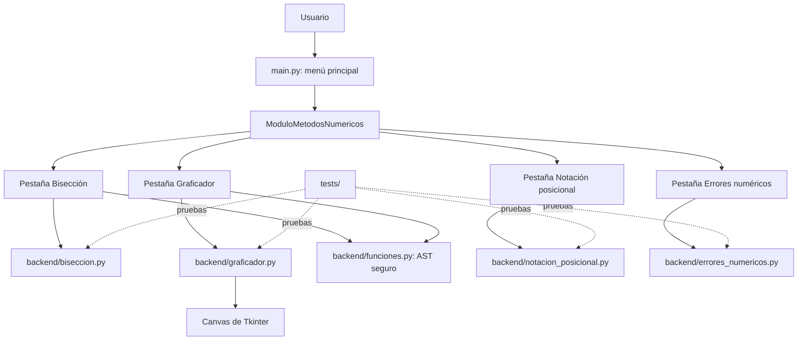

# Calculadora de Álgebra Lineal

## Informe académico y técnico de la Tarea 7: Métodos Numéricos

| Dato | Información |
|---|---|
| Estudiante | ______________________________________________ |
| Integrantes | ______________________________________________ |
| Carrera | ______________________________________________ |
| Grupo | ______________________________________________ |
| Asignatura | Álgebra Lineal (MTM0120) |
| Docente | ______________________________________________ |
| Fecha | ______________________________________________ |

---

## 1. Introducción

La Tarea 7 amplía la calculadora educativa CalculadoraAlgebra con cuatro herramientas de métodos numéricos: búsqueda de raíces por bisección, representación gráfica de funciones, notación posicional decimal y binaria, y análisis de errores numéricos. La actividad combina el cálculo con la interpretación: además de obtener resultados, es necesario explicar las condiciones matemáticas de los métodos, el procedimiento aplicado y los límites de la representación finita en una computadora.

La implementación integra estas opciones en la aplicación de escritorio existente. Los cálculos están separados de la interfaz en módulos de `backend/`, mientras que `modulos/modulo_metodos_numericos.py` ofrece formularios y resultados en una pantalla con pestañas. Las expresiones de función se procesan con un evaluador restringido basado en AST. El presente informe describe la implementación real y distingue los resultados de pruebas automatizadas de la evidencia visual, que deberá agregarse cuando se capturen las pantallas de la aplicación.

## 2. Objetivos

### Objetivo general

Documentar los fundamentos matemáticos, algoritmos, implementación, validación y limitaciones de las cuatro funcionalidades de métodos numéricos incorporadas a CalculadoraAlgebra para la Tarea 7.

### Objetivos específicos

- Explicar el método de bisección, sus hipótesis, la reducción del intervalo y el significado de sus criterios de error y parada.
- Describir cómo se muestrean y dibujan funciones, y cómo se gestionan dominios inválidos y saltos detectados.
- Desarrollar la representación posicional en bases 10 y 2 y verificar las conversiones con los ejemplos de la guía.
- Interpretar los errores absoluto, relativo y porcentual, la representación `float` y una aproximación de propagación mediante derivadas.
- Explicar la arquitectura, la integración con el menú, el evaluador de expresiones y la evidencia disponible de pruebas.
- Señalar las diferencias frente a la guía y los artefactos de entrega que todavía requieren evidencia o preparación.

## 3. Requerimientos de la Tarea 7

La guía de la Universidad Americana pide cuatro módulos integrados en la calculadora, validación clara de datos y funciones, documentación del código, pruebas de los casos indicados y continuidad de los módulos anteriores. La entrega solicitada es un único ZIP con código, informe PDF, instrucciones y capturas de pruebas. La siguiente matriz resume el estado observado en el código y la evidencia disponible.

| Requisito de la guía | Implementación encontrada | Archivo o función que lo demuestra | Evidencia disponible | Estado |
|---|---|---|---|---|
| Incorporar las cuatro opciones al menú y conservar los módulos previos | Una opción abre pestañas de Bisección, Graficador, Notación posicional y Errores numéricos. Los módulos previos permanecen en el menú. | `main.py`; `ModuloMetodosNumericos` en `modulos/modulo_metodos_numericos.py` | Pruebas de integración del menú; suite completa con pruebas de módulos previos. Sin inspección visual. | Cumplido para integración lógica; parcial para evidencia visual de compatibilidad |
| Implementar bisección propia con entradas y validaciones requeridas | Comprueba `a < b`, tolerancia positiva, máximo entero, finitud, evaluación de extremos y cambio de signo; reconoce raíces exactas en extremos. | `resolver_biseccion`, `iteraciones_teoricas` en `backend/biseccion.py` | Pruebas de casos de la guía, raíces exactas y entradas inválidas. | Cumplido |
| Mostrar tabla, cota, errores entre iteraciones y máximo teórico | Registra los extremos usados antes de actualizar, `xr`, valores de función, semiancho, errores aproximados y decisión. | `resolver_biseccion`; `calcular_biseccion` | Pruebas automatizadas de traza y máximo insuficiente; salida reproducida para el caso cúbico. | Cumplido |
| Comparar con `scipy.optimize.bisect` | No se hace la comparación externa. | `modulos/modulo_metodos_numericos.py`; restricción de `AGENTS.md` | La interfaz comunica expresamente la omisión. | Pendiente frente a la guía |
| Graficar al menos mil puntos, respetar dominio y rotular la gráfica | Muestrea 1200 puntos por defecto; la interfaz dibuja título, ejes, graduaciones, cuadrícula y leyenda. | `muestrear_funcion` en `backend/graficador.py`; `dibujar_grafica` | Pruebas de muestreo, límites y exclusión de dominio; inspección del código. | Cumplido |
| Evitar unir ramas a través de discontinuidades | Puntos inválidos crean huecos y los saltos que exceden un umbral basado en IQR separan segmentos. | `muestrear_funcion` | Prueba con `1/x`; 1200 puntos y dos segmentos de 594 puntos en la ejecución reproducida. | Cumplido en el caso probado; la detección general es heurística |
| Marcar raíz y mostrar el intervalo de bisección, identificando cuál se dibuja | Puede marcar la raíz y dibuja la línea del intervalo inicial, pero la línea no tiene rótulo que la identifique como tal. | `dibujar_grafica` en `modulos/modulo_metodos_numericos.py` | Código revisado; no hay captura visual. | Parcial |
| Descomponer y convertir números entre base 10 y base 2 | Presenta dígitos por potencias, conversiones y comprobaciones; admite enteros negativos y cero. | `descomponer_decimal`, `decimal_a_binario`, `binario_a_decimal` en `backend/notacion_posicional.py` | Pruebas de los ejemplos de la guía, negativos, cero e inválidos. | Cumplido para conversiones; parcial en la presentación algebraica de negativos |
| Explicar errores inherente, redondeo, truncamiento, overflow, underflow y modelado | Define los tipos y distingue truncamiento numérico de modelado; incluye ejemplos de overflow y underflow. | `resumen_tipos_error`, `analizar_punto_flotante` | Pruebas de tipos y ejemplos `float`. | Cumplido |
| Mostrar épsilon de máquina mediante `numpy.finfo(float).eps` | Muestra `sys.float_info.epsilon`, con explicación equivalente para `float` de Python. No usa NumPy por la restricción del proyecto. | `analizar_punto_flotante` en `backend/errores_numericos.py` | Prueba automatizada del épsilon. | Parcial respecto a la instrucción literal; equivalente funcional implementado |
| Calcular errores absoluto, relativo y porcentual; tratar valor verdadero cero | Devuelve errores relativos y porcentuales no definidos cuando el valor verdadero es cero. | `calcular_errores` | Pruebas con valores no nulos y verdadero igual a cero. | Cumplido |
| Comparar propagación real y lineal para `sin(x)+x²` | Calcula `f′(x)Δx`, el cambio real y la diferencia absoluta para entradas `x`, `Δx`. | `propagar_error` | Prueba automatizada y ejemplo numérico reproducido. | Cumplido |
| Evitar `eval()` directo y validar expresiones | AST con lista blanca de constantes, operaciones y funciones autorizadas. | `backend/funciones.py` | Pruebas de expresiones admitidas, entradas inválidas y nodos rechazados. | Cumplido |
| Incluir docstrings, comentarios y mensajes claros | Las funciones principales incluyen docstrings; hay validaciones y cuadros de error. Algunos auxiliares no tienen docstrings propios. | `backend/`; `modulos/modulo_metodos_numericos.py` | Inspección de fuentes y pruebas de validación. | Parcial |
| Incluir código modular, informe PDF, portada y nombre de entrega | El código modular existe y `README.md` indica cómo ejecutarlo. Este archivo es Markdown; no se ha preparado aquí el PDF ni el ZIP con nombre oficial. | `main.py`, `backend/`, `modulos/`, `README.md`, este informe | Fuentes del repositorio y borrador de informe. | Parcial; paquete PDF/ZIP pendiente |
| Explicación de bisección de máximo una página | El informe incluye un resumen breve, fórmulas y tabla de ejemplo. El número de páginas debe confirmarse al maquetar/exportar el PDF. | Sección 6.1 de este informe | Contenido Markdown; no hay PDF renderizado. | Parcial hasta revisar maquetación |
| Adjuntar capturas de cuatro módulos y evidencia de módulos anteriores | Se identifican espacios para capturas reales; no se generan imágenes ficticias. | Sección 9.3 de este informe | No hay capturas adjuntas verificadas. | Pendiente |
| Añadir instrucciones de ejecución y librerías necesarias | `README.md` y `requirements.txt` indican ejecución y dependencia externa. | `README.md`, `requirements.txt` | Documentación del proyecto. | Cumplido |

## 4. Arquitectura e integración

La aplicación conserva la separación de responsabilidades del proyecto:

- **`backend/`** implementa algoritmos, validación de datos y resultados estructurados.
- **`modulos/`** implementa formularios, pestañas y presentación de resultados.
- **`tests/`** contiene pruebas unitarias y de integración.
- **`main.py`** registra las opciones del menú y conecta cada opción con su pantalla.

El archivo `main.py` asocia la clave `metodos_numericos` con `ModuloMetodosNumericos`. Esta clase recibe la acción de volver al menú y crea cuatro pestañas. Bisección y graficador comparten la evaluación de expresiones de `backend/funciones.py`. El botón de bisección para graficar copia la expresión y el intervalo inicial a la pestaña del graficador. La interfaz dibuja con `tkinter.Canvas`; no añade una biblioteca de gráficos.



Las pruebas automáticas de regresión incluyen código de módulos previos. Esa evidencia respalda los algoritmos probados, pero no equivale a abrir y revisar visualmente cada pantalla antigua.

## 5. Desarrollo matemático y computacional de los módulos

### 5.1. Método de bisección

**Fundamento.** Si `f` es continua en `[a,b]` y `f(a)f(b)<0`, el teorema de Bolzano garantiza al menos una raíz en ese intervalo. El cambio de signo por sí solo no prueba continuidad: `1/x` cambia de signo entre `-1` y `1`, pero no tiene raíz allí. El programa muestra esta advertencia y rechaza extremos sin cambio de signo; no puede demostrar automáticamente la continuidad de cualquier expresión.

**Algoritmo.** En cada paso se calcula el punto medio `xr=(a+b)/2` y la cota de error por semiancho `Eb=(b-a)/2`. Si `f(xr)=0`, se detiene por raíz exacta en aritmética de punto flotante. Si `Eb≤E`, la aproximación satisface la tolerancia absoluta. En otro caso se conserva la mitad cuyos extremos tienen signos opuestos. La reducción del ancho permite estimar el máximo teórico con `n=ceil(log₂((b-a)/E))`, que el programa compara con las iteraciones realizadas. El máximo del usuario evita ciclos indefinidos; si se alcanza sin cumplir el criterio, el resultado se marca como no garantizado para esa tolerancia.

**Implementación y ejemplo.** `resolver_biseccion` valida entradas y construye la traza; `iteraciones_teoricas` calcula el límite estimado. Para `f(x)=x³−2x−5`, `[2,3]`, `E=10⁻⁴` y máximo 100, los pasos reproducidos son:

| k | Intervalo usado `[a,b]` | `xr` | `f(xr)` | `Eb` |
|---:|---:|---:|---:|---:|
| 1 | [2, 3] | 2.500000000 | 5.625000 | 0.500000 |
| 2 | [2, 2.5] | 2.250000000 | 1.890625 | 0.250000 |
| 3 | [2, 2.25] | 2.125000000 | 0.345703 | 0.125000 |
| 4 | [2, 2.125] | 2.062500000 | −0.351318 | 0.062500 |
| 5 | [2.0625, 2.125] | 2.093750000 | −0.008942 | 0.031250 |
| 6 | [2.09375, 2.125] | 2.109375000 | 0.166836 | 0.015625 |
| 7 | [2.09375, 2.109375] | 2.101562500 | 0.078562 | 0.007813 |
| 8 | [2.09375, 2.1015625] | 2.097656250 | 0.034714 | 0.003906 |
| 9 | [2.09375, 2.09765625] | 2.095703125 | 0.012862 | 0.001953 |
| 10 | [2.09375, 2.095703125] | 2.094726563 | 0.001954 | 0.000977 |
| 11 | [2.09375, 2.094726563] | 2.094238281 | −0.003495 | 0.000488 |
| 12 | [2.094238281, 2.094726563] | 2.094482422 | −0.000771 | 0.000244 |
| 13 | [2.094482422, 2.094726563] | 2.094604492 | 0.000592 | 0.000122 |
| 14 | [2.094482422, 2.094604492] | 2.094543457 | −0.000090 | 0.000061 |

El programa devuelve `xr≈2.09454345703125`, con 14 iteraciones y `Eb=0.00006103515625≤0.0001`. La fila registra los extremos usados antes de actualizar el intervalo. La raíz de referencia de la guía es aproximadamente `2.09455148`; esta comparación es con el valor impreso en la guía, **no** con SciPy. El resultado queda dentro de la tolerancia establecida.

**Límites.** El cálculo usa `float`; la raíz denominada exacta es exacta respecto de esa aritmética. El programa advierte sobre continuidad, pero no certifica la continuidad general de la función. La comparación externa solicitada con SciPy se omite por la restricción del proyecto.

### 5.2. Graficador de funciones

**Fundamento y algoritmo.** Para trazar una función en `[xmin,xmax]`, el backend divide el intervalo en `N−1` subintervalos de igual longitud, donde `N=1200` por defecto, y evalúa `f(x)` en cada uno de esos puntos. La separación horizontal es `Δx=(xmax−xmin)/(N−1)`. Un valor que no está definido, que no es real o que no es finito se representa como un hueco. Si hay límites verticales, también se excluyen los puntos fuera de ellos. La interfaz transforma las coordenadas matemáticas a coordenadas del lienzo mediante escalas lineales para `x` e `y`.

Para construir segmentos, los valores admitidos se ordenan y se calcula un umbral de salto basado en el rango intercuartílico: `umbral=max(10⁻¹²,4(Q3−Q1))`. Si dos puntos consecutivos difieren verticalmente más que ese umbral, se cierra un segmento y comienza otro. Esta heurística reduce la probabilidad de dibujar una línea que atraviese una asíntota; no constituye una prueba matemática de discontinuidad ni detecta necesariamente todas las discontinuidades.

**Implementación y ejemplo.** `muestrear_funcion` genera puntos y segmentos; `dibujar_grafica` dibuja ejes, graduaciones, cuadrícula, título, curva y leyenda en un Canvas de Tkinter. Para `f(x)=1/x` en `[-1,1]`, el backend produjo 1200 posiciones: el punto en `x=0` no se puede evaluar, y la salida contiene dos segmentos de 594 puntos cada uno. La interpretación correcta es que el trazado no conecta la rama negativa con la positiva a través de cero; no existe una raíz en el punto excluido.

Cuando se usa una función con resultado de bisección coincidente, la interfaz puede marcar la raíz aproximada y dibujar el intervalo **inicial** sobre el eje horizontal. Actualmente ese intervalo no tiene un rótulo que indique explícitamente que es el inicial; es una diferencia respecto a la identificación solicitada por la guía. La prueba del backend no sustituye una captura ni una inspección visual del dibujo.

### 5.3. Notación posicional en base 10 y base 2

**Fundamento.** En base `b`, un número con dígitos `dₖ…d₁d₀` representa `Σ dᵢbⁱ`. Cada dígito aporta su valor multiplicado por la potencia correspondiente; sumar esas contribuciones reconstruye el número. En base 10 los dígitos son de 0 a 9 y en base 2 son 0 o 1.

**Implementación y ejemplos.** `descomponer_decimal` desarrolla las cifras decimales; el auxiliar `_digitos_y_suma` recorre los dígitos y calcula cada producto por la potencia correspondiente. `decimal_a_binario` obtiene la cadena binaria con `format(abs(valor), "b")`; `binario_a_decimal` valida que solo haya dígitos 0 y 1, convierte con base 2 y genera la expansión posicional. Python representa estos enteros exactamente, sin redondeo de punto flotante.

Para el ejemplo decimal de la guía:

`(84506)₁₀ = 8·10⁴ + 4·10³ + 5·10² + 0·10¹ + 6·10⁰`

`= 80000 + 4000 + 500 + 0 + 6 = 84506`.

Para el ejemplo binario:

`(11110011)₂ = 1·2⁷ + 1·2⁶ + 1·2⁵ + 1·2⁴ + 0·2³ + 0·2² + 1·2¹ + 1·2⁰`

`= 128 + 64 + 32 + 16 + 0 + 0 + 2 + 1 = 243 = (243)₁₀`.

La conversión inversa de 243 produce `11110011`, por lo que las representaciones son equivalentes. La aplicación acepta negativos y explica que el signo se conserva y la descomposición se hace sobre el valor absoluto. Sin embargo, el texto de la descomposición que genera el backend coloca el signo negativo solo delante del primer sumando (por ejemplo, `−1 × 10^1 + 3 × 10^0` para `−13`), lo cual no equivale a `−13`. Por ello, el ejemplo académico de expansión se presenta con valores positivos y la salida de negativos se reconoce como limitación de formato.

### 5.4. Errores numéricos

#### Errores absoluto, relativo y porcentual

Para un valor verdadero `xᵥ` y una aproximación `xₐ`, el programa utiliza:

`Eₐ = |xᵥ − xₐ|`

`Eᵣ = Eₐ / |xᵥ|`, si `xᵥ ≠ 0`

`Eᵣ(%) = 100 Eᵣ`.

Si `xᵥ=0`, el error relativo y el porcentaje no están definidos; el backend devuelve `None` y la interfaz informa esa condición sin dividir entre cero. Ejemplo: si el valor verdadero es 10 y el aproximado 9, `Eₐ=|10−9|=1`, `Eᵣ=1/10=0.1` y `Eᵣ(%)=10%`. El error absoluto conserva las unidades del valor, mientras que el relativo es adimensional.

#### Representación de punto flotante y épsilon

Los números `float` almacenan una cantidad finita de bits. Algunas fracciones decimales tienen expansión binaria infinita, por lo que se guardan mediante una aproximación redondeada. En el entorno utilizado, `0.1+0.2` resulta `0.30000000000000004`; por eso `0.1+0.2 == 0.3` es falso y la diferencia observada es `5.551115123125783×10⁻¹⁷`.

La guía pide obtener el épsilon con `numpy.finfo(float).eps`. Las reglas del proyecto prohíben NumPy, así que la implementación consulta `sys.float_info.epsilon`. El valor observado fue `2.220446049250313×10⁻¹⁶`, la distancia entre `1.0` y el siguiente `float` representable mayor en esta implementación. No es una medida uniforme del error relativo para cualquier magnitud.

`analizar_punto_flotante` también presenta ejemplos controlados: `1e308*1e308` resulta infinito, `1e-300*1e-300` se redondea a `0.0`, y `(1e16+1)-1e16` resulta `0.0`. Son resultados observados en la implementación ejecutada, no afirmaciones universales sobre todo formato o sistema.

#### Tipos de error y propagación

El backend describe el **error inherente** como incertidumbre presente en los datos de entrada; el **error de redondeo**, como diferencia debida a representar números con precisión finita; el **error de truncamiento**, como sustituir un proceso infinito por uno finito; y el **error de modelado**, como la diferencia entre el fenómeno y la ecuación idealizada. Truncamiento numérico y modelado son fuentes distintas: aumentar la precisión no elimina por sí solo una simplificación inadecuada del modelo. La interfaz ilustra overflow cuando la magnitud excede el rango representable y underflow cuando cae por debajo de la resolución y aquí termina en cero.

Para `f(x)=sin(x)+x²`, la derivada es `f′(x)=cos(x)+2x`. La linealización de primer orden estima el cambio mediante `Δy_aprox≈f′(x)Δx`; el cambio real es `Δy_real=f(x+Δx)−f(x)`. El módulo calcula también `|Δy_real−Δy_aprox|`.

Con `x=0.5` radianes y `Δx=0.01`, la ejecución del backend dio `f′(x)≈1.87758256189`, `Δy_aprox≈0.01877582562`, `Δy_real≈0.01885170828` y diferencia absoluta `≈0.00007588266`. La discrepancia refleja los términos de orden superior que la aproximación lineal omite. En general, la linealización es más adecuada para perturbaciones pequeñas, aunque la magnitud del error depende de la función y del punto.

## 6. Evaluación segura de expresiones matemáticas mediante AST

`backend/funciones.py` convierte el texto en un árbol sintáctico con `ast.parse(..., mode="eval")` y valida cada nodo mediante una lista blanca. Admite la variable `x`, constantes `pi` y `e`, signos unarios, suma, resta, multiplicación, división, potencia y las funciones `sin`, `cos`, `tan`, `asin`, `acos`, `atan`, `sqrt`, `log`, `log10`, `exp` y `abs`. `log` acepta uno o dos argumentos; las demás funciones, uno.

La expresión se limita a 500 caracteres, 100 nodos AST y exponentes de magnitud máxima 1000. Se rechazan atributos, nombres desconocidos, llamadas no permitidas, argumentos nombrados y construcciones de Python ajenas al lenguaje matemático previsto. La evaluación recursiva usa `operator` y `math`; controla división por cero, errores de dominio, números complejos y resultados no finitos. El resultado se convierte a `float` para los cálculos numéricos.

Así, una expresión como `x**3 - 2*x - 5` puede evaluarse para bisección y graficación con el mismo componente. Texto como una llamada arbitraria o acceso a atributos se rechaza, y no se ejecuta `eval()` sobre entrada del usuario. La lista blanca reduce el lenguaje aceptado intencionalmente; no es un intérprete de Python general.

## 7. Tecnologías, bibliotecas y métodos utilizados

| Tecnología o método | Uso en el proyecto |
|---|---|
| Python | Implementación del backend, interfaz y pruebas. |
| CustomTkinter | Formularios, ventanas, pestañas y controles de la aplicación de escritorio. |
| Tkinter Canvas | Dibujo de ejes, cuadrícula, curva, marcadores y leyenda. |
| `ast` | Análisis sintáctico y validación controlada de expresiones matemáticas. |
| `math` | Funciones trascendentes, finitud y cálculo de la cota teórica de iteraciones. |
| `sys.float_info.epsilon` | Consulta del épsilon de `float` sin NumPy. |
| `unittest` | Pruebas unitarias y de integración disponibles en `tests/`. |
| Bisección | Reducción sucesiva del intervalo que conserva cambio de signo. |
| Notación posicional | Desarrollo de dígitos como suma de productos por potencias de la base. |
| Linealización diferencial | Aproximación local `Δy≈f′(x)Δx` para estudiar propagación. |

La guía permite bibliotecas científicas, pero `AGENTS.md` prohíbe NumPy y SciPy. Por eso se usó el algoritmo propio de bisección, `sys.float_info.epsilon` y Canvas. No se añadieron dependencias gráficas. `requirements.txt` declara `customtkinter>=5.2`; Python incluye los módulos estándar empleados.

## 8. Pruebas realizadas y resultados obtenidos

En la auditoría técnica se ejecutó:

```text
python -m unittest discover -s tests -v
```

**Resultado verificado: 84 pruebas ejecutadas, 84 aprobadas y 0 fallidas.** Las pruebas son automatizadas y comprueban el comportamiento de backend, además de algunos aspectos de integración. No son una validación visual de la GUI.

| Área | Casos comprobados por las pruebas disponibles | Resultado |
|---|---|---|
| Bisección | Los cuatro casos de referencia de la guía; raíz en extremo e intermedia; intervalo sin cambio de signo; discontinuidad de `1/x` en el punto medio; máximo insuficiente; tolerancia, extremos y máximo inválidos. | Aprobados |
| Evaluador AST | Operadores y funciones aceptadas; rechazo de código, atributos, nombres y nodos no permitidos; sintaxis, complejidad, división por cero, dominio y resultados no finitos. | Aprobados |
| Graficador | Mínimo de puntos, límites, validación de intervalo, exclusión de dominio de `sqrt(x)` y separación de segmentos para `1/x`. | Aprobados |
| Notación posicional | Ejemplos `84506` y `11110011₂`; negativos, cero, caracteres binarios inválidos y entrada no entera. | Aprobados |
| Errores numéricos | Errores absoluto, relativo y porcentual; valor verdadero cero; épsilon, overflow, underflow, pérdida de precisión, tipos y propagación. | Aprobados |
| Integración y regresión | Registro del menú de métodos numéricos, resumen teórico y pruebas del conjunto de módulos anteriores. | Aprobados |

### 8.1. Tipos de evidencia

- **Pruebas unitarias automatizadas:** son las 84 pruebas de `unittest`; comprobaron funciones matemáticas y validaciones.
- **Verificación funcional del backend:** se reprodujeron salidas directamente desde las funciones actuales para el ejemplo de bisección, el muestreo de `1/x`, los ejemplos posicionales, el cálculo de errores y la propagación.
- **Inspección del código:** se revisaron los módulos de backend, la interfaz, las pruebas y los archivos de documentación relevantes.
- **Validación visual:** no se inspeccionó manualmente la interfaz durante la auditoría. Por tanto, no se afirma que el diseño final de las cuatro pestañas haya sido verificado visualmente.

Los resultados numéricos citados en este documento provienen del código actual y de la ejecución reproducida. La suite no prueba todos los comportamientos posibles ni sustituye las capturas que exige la entrega.

### 8.2. Espacios para evidencias gráficas

Insertar aquí capturas tomadas de la aplicación real. Los recuadros son marcadores editoriales, no imágenes de resultados.

**Evidencia 1. Bisección —** función, intervalo, tolerancia, tabla y criterio de terminación visibles.

> `[INSERTAR CAPTURA REAL: pestaña Bisección con x**3 - 2*x - 5, [2,3], E=0.0001 y tabla]`

**Evidencia 2. Graficador —** función racional `1/x` en un intervalo que cruce cero, mostrando las ramas separadas.

> `[INSERTAR CAPTURA REAL: pestaña Graficador con la gráfica de 1/x y el intervalo elegido]`

**Evidencia 3. Notación posicional —** desarrollo de `84506` en base 10 y verificación de `11110011₂ = 243₁₀`.

> `[INSERTAR CAPTURA REAL: pestaña Notación posicional con las expansiones y conversiones]`

**Evidencia 4. Errores numéricos —** punto flotante, cálculo de errores y propagación con los valores de ejemplo.

> `[INSERTAR CAPTURA REAL: pestaña Errores numéricos con resultados y fórmulas visibles]`

**Evidencia 5. Compatibilidad —** menú principal con módulos anteriores y una operación ejecutada en al menos un módulo previo.

> `[INSERTAR CAPTURA REAL: menú principal y pantalla de un módulo anterior funcionando]`

## 9. Limitaciones y diferencias respecto al enunciado original

1. **Contraste con SciPy pendiente.** La guía solicita comparar bisección con `scipy.optimize.bisect` cuando correspondan las hipótesis. No se implementó porque `AGENTS.md` prohíbe SciPy. El informe no atribuye al programa una comparación que no realizó.
2. **Épsilon sin NumPy.** La guía pide `numpy.finfo(float).eps`; el proyecto prohíbe NumPy. La aplicación muestra el valor equivalente mediante `sys.float_info.epsilon`.
3. **Identificación gráfica incompleta.** La línea dibujada corresponde al intervalo inicial, pero la interfaz no la etiqueta con ese nombre. La raíz aproximada sí puede marcarse cuando queda dentro de los límites visibles.
4. **Detección gráfica heurística.** Los saltos se separan usando los puntos muestreados y un umbral estadístico; no es una garantía de detección de toda discontinuidad posible.
5. **Formato de números negativos.** El valor y su conversión conservan el signo, pero la cadena de expansión posicional del backend antepone el signo solo al primer término. La suma puede parecer algebraicamente incorrecta, por lo que debe mejorarse antes de usar esa salida como desarrollo formal de un negativo.
6. **Interfaz sin revisión visual documentada.** La auditoría confirma pruebas automatizadas y comportamiento del backend, pero no una inspección visual de las pestañas.
7. **Artefactos de entrega pendientes.** El enunciado solicita ZIP con nombre definido, PDF con portada y capturas. Este archivo Markdown no sustituye el PDF; los espacios de evidencia de la sección 8.2 deben reemplazarse por capturas reales antes de entregar.

## 10. Conclusiones y observaciones técnicas

La implementación integra las cuatro funcionalidades principales de la Tarea 7 y las mantiene separadas entre lógica matemática y presentación. Bisección aplica la reducción iterativa del intervalo y muestra sus trazas y cota; el graficador muestrea funciones y separa puntos inválidos o saltos detectados; la notación posicional desarrolla las cifras en potencias de la base; y el módulo de errores calcula magnitudes y compara un cambio real con su aproximación diferencial.

La suite actual ejecutó 84 pruebas con todas aprobadas. Esa evidencia respalda los casos automatizados para los cuatro módulos y parte de la regresión del proyecto, sin demostrar por sí sola el comportamiento visual de la aplicación. Los ejemplos numéricos se verificaron desde las funciones actuales. Las diferencias de SciPy y NumPy se explican por las reglas del repositorio, mientras que el rótulo del intervalo, la presentación algebraica de negativos y las capturas permanecen como aspectos pendientes.

Para la defensa individual, conviene poder explicar por qué bisección requiere continuidad además del cambio de signo, cómo la cota depende del ancho del intervalo, por qué el muestreo no prueba continuidad, cómo las potencias reconstruyen una representación posicional y por qué una derivada aproxima el cambio para perturbaciones pequeñas. También debe distinguirse la evidencia de pruebas de la evidencia visual solicitada para la entrega.

## 11. Instrucciones de ejecución

1. Instalar Python 3 con Tkinter disponible.
2. Instalar la dependencia externa del proyecto desde la raíz:

   ```text
   python -m pip install -r requirements.txt
   ```

3. Iniciar la calculadora:

   ```text
   python main.py
   ```

El `README.md` indica que `main.py` también instala CustomTkinter automáticamente si falta, lo que requiere acceso a Internet en esa primera ocasión. No se requieren NumPy, SciPy ni bibliotecas gráficas adicionales para los módulos descritos.

## 12. Referencias bibliográficas

1. Universidad Americana, Facultad de Ingeniería y Arquitectura. *Actividades de Programación en Python — Programa 7: Métodos Numéricos: Bisección, Graficador de Funciones, Notación Posicional y Errores Numéricos*. Documento de la asignatura: `docs/Tarea 7 (Elaboracion Programa 7_Python).pdf`.
2. Python Software Foundation. *Documentación oficial de Python 3*: [`ast`](https://docs.python.org/3/library/ast.html), [`math`](https://docs.python.org/3/library/math.html), [`sys`](https://docs.python.org/3/library/sys.html), [`tkinter`](https://docs.python.org/3/library/tkinter.html) y [`unittest`](https://docs.python.org/3/library/unittest.html).
3. Tom Schimansky. *CustomTkinter Documentation*. [https://customtkinter.tomschimansky.com/](https://customtkinter.tomschimansky.com/).
4. Proyecto CalculadoraAlgebra. `AGENTS.md`, `README.md`, `requirements.txt`, módulos en `backend/` y `modulos/`, y pruebas en `tests/`. Código y documentación fuente del proyecto.

## Nota de fuentes y alcance

Se consultaron el PDF de la Tarea 7, el borrador existente, `AGENTS.md`, `README.md`, `requirements.txt`, el código de backend y presentación, y las pruebas disponibles. Se buscó un archivo Repomix en el espacio de trabajo, pero no se encontró; por ello no se utilizó ni se atribuye información a ese archivo. La matriz y los resultados se basan en las fuentes presentes y en las 84 pruebas ejecutadas en la auditoría técnica.
